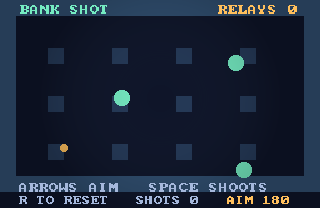

# AGGE

**Artificial General Game Engine** is a free, open-source, agent-first 2D game engine written in Rust and licensed under MIT. It runs locally and includes a visual editor, a game scripting language, a desktop player, a CLI, and a native MCP server. The editor, CLI, and MCP server share the same project model and transaction layer, so developers and coding agents can work on the same game.

## Agent-first from project files to playtests

AGGE is designed to minimize the tokens a coding agent needs to build, change, and verify a game. The principle applies throughout the engine. Whenever AGGE can do a job deterministically, it should do that work itself so the agent can focus on game design and behavior.

- **Read only what the change needs.** Compact, Git-friendly project files and an indexed resource graph let agents request a single field, placement, script event, or symbol reference. Batch related reads at one revision, and use a named checkpoint to retrieve changes between sessions.
- **Describe edits at the level of intent.** A grid placement, tile stamp, or typed rename can replace pages of generated data or repeated edits. Edits support previews and replay checks before committing one undoable transaction. Concise scripts use engine primitives for game logic such as input and collision.
- **Verify with the game runtime.** Studio copies playtests as replay JSON. Agents can assert specific outcomes, sample selected values across ticks, or request a small PNG crop.

AGGE targets **80–90% fewer tokens on suitable tasks**. Five scripted edit workflows measured **7.9–59.5% lower token counts** against equivalent Godot workflows. On the Bank Shot fixture, samples across six ticks used **78.7% fewer tokens** than six state snapshots, and retrieving a single edit form used **89.1% fewer tokens** than retrieving the full catalog. End-to-end model-session savings are still unverified. [Benchmark results and reproduction steps](bench/README.md)

## Play or edit a game

Install Rust 1.89 or newer. On Linux, install ALSA and the development libraries for your desktop graphics stack. For Ubuntu, the CI setup uses `pkg-config libasound2-dev libgl1-mesa-dev libxkbcommon-dev libwayland-dev`.

```sh
cargo build --workspace --release --locked
cargo run -p agge-studio --bin agge-studio -- examples/orbit/game.agge
cargo run -p agge-studio --bin agge-player -- examples/paddle/game.agge
cargo run -p agge -- test examples/bankshot/game.agge @examples/bankshot/replay.json
```

| Example | Play and explore |
| --- | --- |
| [Signal Runner](examples/orbit) | Collect power cells, avoid a patrol, and explore sprite atlases, lighting, and sound. |
| [Rail Paddle](examples/paddle) | Keep the ball in play with a paddle and build up your hit count. |
| [Relay Courier](examples/relay) | Navigate barriers and reach the gate in a scrolling room. |
| [Switchback](examples/switchback) | Jump through one-way platforms, collect two chips, and restore the lift. |
| [Bank Shot](examples/bankshot) | Aim with the arrows, launch with Space, and rebound into three relays within three shots. Reset with R. |



## Learn AGGE

- [Editor and first game](docs/first-game.md) covers building a playable room, creating a replay, and packaging a desktop build.
- [Project and scripting reference](docs/reference.md) describes assets, serialization, input, collision, and the language.
- [Agent interface](docs/agents.md) documents MCP setup, revision checks, operations, checkpoints, and selective inspection.
- [Architecture](docs/architecture.md) describes crate boundaries, determinism, and the current limits.
- [Benchmarks](bench/README.md) record measured workflow token counts and describe how to collect model-session usage.
- [Contributing](CONTRIBUTING.md) covers development checks, fixtures, and benchmark evidence.

## Current release scope

The editor supports room placement, object properties, sprite-sheet frames, animation playback, tile painting, scripts, audio audition, and particle previews. The runtime supports fixed-step movement and AABB collision, gravity, scrolling cameras, sprites, animation, room lighting, sound, keyboard actions, HUD labels, and particles. The Windows editor, headless workflow, and desktop package were exercised locally. CI is configured for Windows, Linux, and macOS builds.

The engine is at version 0.1. It has no browser or mobile player, rigid-body solver, in-editor pixel painter, or general UI layout system.

## Development

```sh
cargo fmt --all -- --check
cargo clippy --workspace --all-targets --locked -- -D warnings
cargo test --workspace --locked
```

The engine and bundled examples are distributed under the [MIT License](LICENSE).
