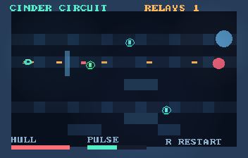

# AGGE

**Artificial General Game Engine** is a free, open-source, agent-first 2D game engine written in Rust and licensed under MIT. It runs locally and includes a visual editor, a game scripting language, a desktop player, a CLI, and a native MCP server. The editor, CLI, and MCP server share the same project model and transaction layer, so developers and coding agents can work on the same game.

## Agent-first from project files to playtests

AGGE is designed to minimize the tokens a coding agent needs to build, change, and verify a game. The principle applies throughout the engine. Whenever AGGE can do a job deterministically, it should do that work itself so the agent can focus on game design and behavior.

- **Read only what the change needs.** Compact, Git-friendly project files and an indexed resource graph let agents request a single field, placement, script event, or symbol reference. Batch related reads at one revision, and use a named checkpoint to retrieve changes between sessions.
- **Describe edits at the level of intent.** A grid placement, tile stamp, or typed rename can replace pages of generated data or repeated edits. Edits support previews and replay checks before committing one undoable transaction. Concise scripts use engine primitives for game logic such as input and collision.
- **Author pixel art in source.** Reuse palettes, layered components, and named poses, then patch a small region and inspect its pixels or a contact sheet. The same artwork feeds Studio, sprite animations, tilesets, and standalone games.
- **Verify with the game runtime.** Studio records playtests and plays back saved replays with live assertions. Agents can test multiple named scenarios from one compiled project, sample selected values across ticks, or request a small PNG crop.

AGGE targets **80–90% fewer tokens on suitable tasks**. Six scripted edit workflows measured **7.9–59.5% lower token counts** against equivalent Godot workflows. On the Bank Shot fixture, samples across six ticks used **78.7% fewer tokens** than six state snapshots. End-to-end model-session savings are still unverified. [Benchmark results and reproduction steps](bench/README.md)

## Play or edit a game

Install Rust 1.89 or newer. On Linux, install ALSA and the development libraries for your desktop graphics stack. For Ubuntu, the CI setup uses `pkg-config libasound2-dev libgl1-mesa-dev libxkbcommon-dev libwayland-dev`.

```sh
cargo build --workspace --release --locked
cargo run -p agge-studio --bin agge-studio -- examples/orbit/game.agge
cargo run -p agge-studio --bin agge-player -- examples/paddle/game.agge
cargo run -p agge -- test examples/bankshot/game.agge @examples/bankshot/replay.json
```

| Example | Play and explore |
| --- | --- |
| [Signal Runner](examples/orbit) | Collect power cells, avoid a patrol, and explore sprite atlases, lighting, and sound. |
| [Rail Paddle](examples/paddle) | Keep the ball in play with a paddle and build up your hit count. |
| [Relay Courier](examples/relay) | Navigate barriers and reach the gate in a scrolling room. |
| [Switchback](examples/switchback) | Jump through one-way platforms, collect two chips, and restore the lift. |
| [Bank Shot](examples/bankshot) | Aim with the arrows, launch with Space, and rebound into three relays within three shots. Reset with R. |
| [Cinder Circuit](examples/cinder) | Restore three relays while dodging sentry fire. Uses collision filters, animated effects, timers, looped music, and live HUD meters. |
| [Pulse Lock](examples/pulse_lock) | Time three taps as a cursor sweeps across the gates. Uses a custom keyboard action and replay-verified timing. |
| [Brassline Foundry](examples/pixel_foundry) | Inspect a layered diver, a mirrored crab, animated welds, a recolored rival, and a tileset drawn entirely with the native sprite DSL. |



## Learn AGGE

- [Editor and first game](docs/first-game.md) covers building a playable room, creating a replay, and packaging a desktop build.
- [Install from source](docs/install.md) covers local binaries, desktop dependencies, and how to run the example suite.
- [Project and scripting reference](docs/reference.md) describes assets, serialization, input, collision, and the language.
- [Pixel-art authoring](docs/pixel-art.md) covers palettes, reusable layers and poses, scoped edits, and PNG feedback.
- [Agent interface](docs/agents.md) documents MCP setup, revision checks, operations, checkpoints, and selective inspection.
- [Architecture](docs/architecture.md) describes crate boundaries, determinism, and the current limits.
- [Benchmarks](bench/README.md) record measured workflow token counts and describe how to collect model-session usage.
- [Contributing](CONTRIBUTING.md) covers development checks, fixtures, and benchmark evidence.

## Current release scope

The editor supports room placement, object properties, sprite-sheet frames, animation scrubbing, tile painting, scripts, audio audition, and particle previews. The runtime supports fixed-step movement, filtered AABB collision, gravity, scrolling cameras, depth and Y sorting, three animation modes, room lighting, effects audio and looped music, keyboard actions, HUD meters and labels, and particles. CI covers Windows, Linux, and macOS.

The engine is at version 0.1. Browser and mobile players, a rigid-body solver, and a general UI layout system are outside this release.

## Development

```sh
cargo fmt --all -- --check
cargo clippy --workspace --all-targets --locked -- -D warnings
cargo test --workspace --locked
```

The engine and bundled examples are distributed under the [MIT License](LICENSE).
