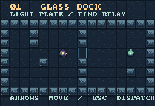

# Glass Yard

Run two night shifts as a courier in a tiled freight yard. Use the arrow keys to reach the pressure plate, cross the opened gate, and deliver to the beacon. Enter starts the dock shift. Completing it unlocks the relay shift from the title screen. Press Up at dispatch to enter the relay and Escape to return to dispatch.

```sh
agge-player --progress glass-yard-test.json examples/glass_yard/game.agge
agge test examples/glass_yard/game.agge '@examples/glass_yard/replay.json'
```

The project uses native pixel assets for all sprites and terrain, with a directional material ramp on the steel walls. A plate updates its tile and collider in the same tick, changes its animation, and plays a panned cue. The higher-priority finish cue accompanies a progress save. The replay suite checks the dock shift, an initially locked relay, and a relay victory from a version 1 progress file.


