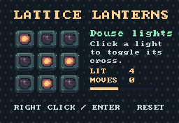

# Lattice Lanterns

Click a lantern to toggle it and its orthogonal neighbors. Douse all nine. Right-click or press Enter to reset. The opening puzzle takes two moves.

```sh
agge-player examples/lattice/game.agge
agge test examples/lattice/game.agge '@examples/lattice/replay.json'
```

The replay exercises the solution, a click off the board, and both reset paths. The lantern frames and repeating background are native `pixel` assets. The controller reads pointer coordinates once per click and the tiles reuse that result to apply the same rule.


