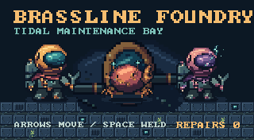

# Brassline Foundry



Move with the arrows and press Space to weld. Open the project in Studio and select a **Pixel artwork** entry to scrub poses or isolate its layers.

| Artwork | What to inspect |
| --- | --- |
| `diver` | Asymmetric silhouette, articulated tool, scarf, tinted glass, and exact highlights. Reuses `helm` and `spanner`. |
| `rival` | The same body plates under the `oxide` profile with a new insignia and independent head motion. |
| `scuttler` | Mirrored legs, tinted shell shading, an asymmetrical claw, and separate poses for the claw and legs. |
| `bulkhead` and `deck` | Metal bevels, corrosion clusters, exposed pipes, a hatch, and four atlas variants. |
| `arc` | Translucent glyphs, outline, sparks, and generated movement. |

```sh
agge test examples/pixel_foundry/game.agge '@examples/pixel_foundry/replay.json'
```

The replay checks locomotion, weld activation, a specific animation frame, and return to idle. Native artwork is embedded in `game.agge`. The preview image is documentation.
